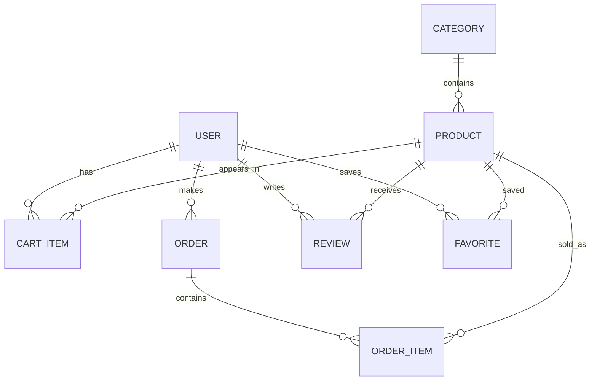
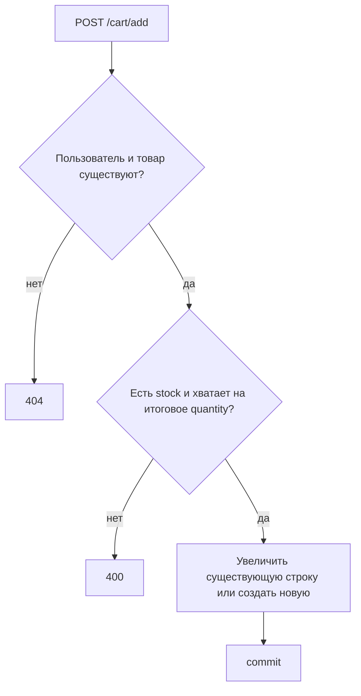
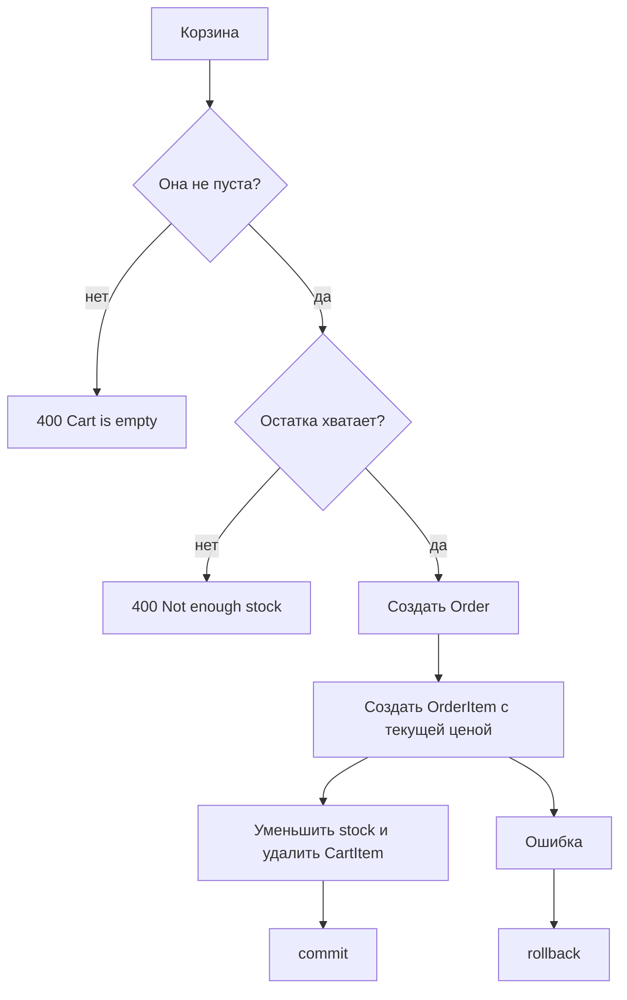

# 🛍️ FastAPI Online Store — учебное пособие по проекту

> Это руководство описывает **текущую версию** учебного Backend-проекта. Оно создано для подготовки к защите: здесь объясняются реальные файлы, модели, функции и маршруты, без вымышленных возможностей.

## Содержание

- [1. Идея и архитектура](#1-идея-и-архитектура)
- [2. Технологии](#2-технологии)
- [3. Структура проекта](#3-структура-проекта)
- [4. База данных и модели](#4-база-данных-и-модели)
- [5. Pydantic-схемы и валидация](#5-pydantic-схемы-и-валидация)
- [6. SQLAlchemy в этом проекте](#6-sqlalchemy-в-этом-проекте)
- [7. Разбор всех функций](#7-разбор-всех-функций)
- [8. Справочник API](#8-справочник-api)
- [9. Бизнес-логика магазина](#9-бизнес-логика-магазина)
- [10. Поиск, фильтры, сортировка и страницы](#10-поиск-фильтры-сортировка-и-страницы)
- [11. Ошибки и HTTP-статусы](#11-ошибки-и-http-статусы)
- [12. Запуск на Windows](#12-запуск-на-windows)
- [13. Вопросы к защите](#13-вопросы-к-защите)
- [14. Словарь терминов](#14-словарь-терминов)

---

## 1. Идея и архитектура

**FastAPI Online Store** — Backend учебного интернет-магазина. Он хранит пользователей, категории, товары, корзины, заказы, отзывы и избранное. Через HTTP-запросы клиент может читать и изменять эти данные.

REST API — это способ общения программ по HTTP. У каждого адреса (endpoint) есть действие: например, `GET /products/` получает товары, а `POST /products/` создаёт товар. Клиентом может быть Frontend, Postman или встроенный Swagger UI FastAPI.

```text
Клиент / Swagger UI
        │ JSON-запрос и JSON-ответ
        ▼
     main.py (FastAPI routes)
        │ вызывает
        ▼
     crud.py (работа с данными)
        │ SQLAlchemy ORM
        ▼
 model.py ───── database.py
        │              │
        └──────────────▼
                    SQLite database.db
```

Авторизации в проекте нет: пользователь передаёт `user_id` в пути, query-параметрах или теле запроса. Для учебного CRUD-проекта это упрощает примеры. В настоящем магазине проверять, что пользователь имеет право передавать любой `user_id`, было бы недостаточно.

## 2. Технологии

| Технология | Роль в проекте | Где видна в коде |
|---|---|---|
| Python | Язык Backend | все `.py` файлы |
| FastAPI | маршруты, параметры, ошибки, OpenAPI | `main.py` |
| SQLAlchemy | ORM: Python-модели и запросы к БД | `model.py`, `crud.py`, `database.py` |
| SQLite | файловая реляционная БД | `database.db`, строка URL в `database.py` |
| Pydantic | проверка JSON и формирование ответов | `schemas.py`, `main.py` |
| Uvicorn | ASGI-сервер для запуска FastAPI | `requirements.txt`, команда запуска |
| Swagger UI | интерактивная документация `/docs` | автоматически предоставляет FastAPI |
| Git / GitHub | история изменений и удалённый репозиторий | `.git`, GitHub-репозиторий |

### Примеры из проекта

```python
# FastAPI: маршрут и модель ответа
@app.get("/products/", response_model=list[ProductResponse])
def read_products(...):
    return get_products(...)

# SQLAlchemy: поиск первой записи
db.query(User).filter(User.id == user_id).first()

# Pydantic: ограничение входного числа
quantity: int = Field(default=1, ge=1)
```

`requirements.txt` намеренно содержит только три прямые зависимости: `fastapi`, `sqlalchemy`, `uvicorn`. Отдельной библиотеки для авторизации, миграций, Redis, Docker или внешних API в проекте нет.

## 3. Структура проекта

```text
fastapi-exam1/
├── main.py              # FastAPI-приложение и все HTTP-маршруты
├── crud.py              # запросы и операции с базой
├── model.py             # SQLAlchemy-модели таблиц и связи
├── schemas.py           # Pydantic-входы и ответы
├── database.py          # engine, сессии и Base
├── database.db          # SQLite-данные (не редактируется вручную)
├── requirements.txt     # зависимости Python
├── .gitignore           # исключения Git
├── README.md            # краткое описание и запуск
└── PROJECT_GUIDE.md     # это учебное пособие
```

В основной схеме специально не показаны `.venv`, `__pycache__` и `.pytest_cache`: это локальные/временные каталоги. `.gitignore` исключает их, а также `.runtime`, `database.db` и файлы `.env` из новых коммитов.

| Файл | Что содержит | С кем связан |
|---|---|---|
| `database.py` | подключение и выдачу `Session` | импортируется моделями и `main.py` |
| `model.py` | таблицы и отношения ORM | использует `Base`, используется CRUD |
| `schemas.py` | формы входящих и исходящих данных | используется маршрутами |
| `crud.py` | сохранение, поиск, обновление, удаление | использует модели и сессию |
| `main.py` | HTTP API и бизнес-проверки | объединяет все предыдущие файлы |

---

## 4. База данных и модели

### Подключение: `database.py`

```python
SQLALCHEMY_DATABASE_URL = "sqlite:///./database.db"
engine = create_engine(SQLALCHEMY_DATABASE_URL,
                       connect_args={"check_same_thread": False})
SessionLocal = sessionmaker(autocommit=False, autoflush=False, bind=engine)
```

`engine` знает, как подключаться к SQLite. `SessionLocal` создаёт сессии — объекты, через которые выполняются запросы и фиксируются изменения. `Base(DeclarativeBase)` — общий родитель всех моделей. В `main.py` строка `Base.metadata.create_all(bind=engine)` создаёт отсутствующие таблицы.

### Таблицы

#### `User` — пользователи

| Поле | Тип | Назначение / ограничение |
|---|---|---|
| `id` | int | первичный ключ, индекс |
| `name` | string | обязательное имя |
| `email` | string | обязательный, уникальный, индекс |

Связи: `cart_items`, `orders`, `reviews`, `favorites`. Для этих дочерних коллекций используется `cascade="all, delete-orphan"`: при удалении пользователя связанные корзины, заказы, отзывы и избранное удаляются ORM вместе с ним.

Пример: `User(id=1, name="Ali", email="ali@example.com")`.

#### `Category` — категории

`id` — ключ; `name` — обязательное уникальное название; `description` — необязательный текст. Связь `products` содержит товары категории. Перед удалением категории endpoint проверяет, что в ней нет товаров.

#### `Product` — товары

| Поле | Тип | Значение |
|---|---|---|
| `id` | int | ключ |
| `name` | string | обязательное название, индекс |
| `description` | text / null | описание |
| `price` | float | цена |
| `stock` | int | остаток, по умолчанию 0 |
| `category_id` | int | `ForeignKey("categories.id")` |

`category` — категория товара. `cart_items`, `reviews`, `favorites` удаляются с товаром; `order_items` **не** имеют каскада, поэтому endpoint запрещает удалить товар, который уже есть в заказе. Это сохраняет историю заказа.

#### `CartItem` — строка корзины

Хранит `user_id`, `product_id` и `quantity`. `UniqueConstraint("user_id", "product_id")` не разрешает одну и ту же пару пользователь–товар дважды. Связи `user` и `product` позволяют получить сам товар и владельца.

```python
@property
def subtotal(self):
    return self.quantity * self.product.price
```

`subtotal` не колонка в SQLite: это вычисляемое свойство. Например, 3 товара по 10.0 дают 30.0.

#### `Order` и `OrderItem` — заказ и его строки

`Order` хранит пользователя, статус (`new`, `paid`, `cancelled`), итог `total_amount` и дату `created_at`. Его `items` — список `OrderItem`.

`OrderItem` хранит `order_id`, `product_id`, `quantity` и отдельную `price`. Отдельная цена важна: если цена товара позже изменится, старый заказ сохранит цену покупки. Его `subtotal` равен `quantity * price`.

#### `Review` — отзыв

Имеет пользователя, товар, оценку, необязательный комментарий и дату. Связан с `User` и `Product`; диапазон оценки 1–5 проверяет Pydantic-схема.

#### `Favorite` — избранное

Это отдельная таблица-связка между `User` и `Product`. Уникальное ограничение `unique_favorite_product` не допускает повторного добавления одного товара в избранное одного пользователя.

### Связи и ER-схема



One-to-Many («один-ко-многим») означает, например, что одна категория содержит много товаров, но у каждого товара одна категория. Many-to-One — обратный взгляд: много товаров относятся к одной категории.

## 5. Pydantic-схемы и валидация

SQLAlchemy-модель описывает хранение в БД. Pydantic-схема описывает форму данных API: что разрешено получить от клиента и что безопасно вернуть в JSON.

Все схемы наследуются от `Schema`, а он от `BaseModel`:

```python
class Schema(BaseModel):
    model_config = ConfigDict(from_attributes=True, str_strip_whitespace=True)
```

`from_attributes=True` позволяет создать response из ORM-объекта, например `ProductResponse.model_validate(product)`. `str_strip_whitespace=True` убирает пробелы по краям строк. `Field` задаёт простые ограничения.

> **Текущий факт:** `field_validator` в `schemas.py` не используется. В частности, пользовательская проверка формата email была удалена; сейчас email ограничен только длиной 5–255 символов. Поэтому `field_validator` нельзя называть реализованной возможностью проекта.

| Схема | Назначение и ключевые поля | Использование |
|---|---|---|
| `UserCreate` | `name`, `email` | `POST /users/` |
| `UserUpdate` | необязательные `name`, `email` | `PUT /users/{id}` |
| `CategoryCreate`, `CategoryUpdate` | имя, описание | POST/PUT категорий |
| `ProductCreate`, `ProductUpdate` | товар; `price > 0`, `stock >= 0` | POST/PUT товаров |
| `CartItemCreate` | `user_id`, `product_id`, `quantity >= 1` | добавление в корзину |
| `CartItemUpdate` | `quantity >= 1`, `operation` | PATCH строки корзины |
| `OrderCreate` | `user_id` | создание заказа |
| `OrderStatusUpdate` | `Literal["new", "paid", "cancelled"]` | изменение статуса |
| `ReviewCreate` | `user_id`, оценка 1–5, комментарий | создание отзыва |
| `FavoriteCreate` | `user_id`, `product_id` | добавление избранного |
| `UserResponse`, `CategoryResponse`, `ProductResponse` | поля объекта для ответа | `response_model` |
| `CartItemResponse`, `CartResponse` | вложенный товар, subtotal, total | ответы корзины |
| `OrderItemResponse`, `OrderResponse` | вложенные строки заказа и товары | ответы заказов и истории |

`Literal` ограничивает текст фиксированным списком. Например, `operation` может быть только `set`, `increase` или `decrease`; неверное значение даст 422 до входа в endpoint.

Правильное тело создания товара:

```json
{"name":"Keyboard","description":"Mechanical","price":75.5,"stock":10,"category_id":1}
```

Неправильное тело: `{"price": 0, "stock": -1}` — не проходит `Field(gt=0)` и `Field(ge=0)`.

## 6. SQLAlchemy в этом проекте

| Метод / объект | Что делает | Реальный пример |
|---|---|---|
| `query(Model)` | начинает ORM-запрос | `db.query(Product)` |
| `filter(...)` | отбирает записи по условию | `.filter(Product.stock < 5)` |
| `first()` | первую запись или `None` | поиск пользователя по ID |
| `all()` | список всех результатов | список отзывов |
| `count()` | число строк | `db.query(User).count()` |
| `order_by()` | сортирует результаты | `.order_by(Product.price.desc())` |
| `offset()` | пропускает первые строки | `.offset(skip)` |
| `limit()` | ограничивает размер выборки | `.limit(limit)` |
| `ilike()` | поиск без учёта регистра | `Product.name.ilike("%mouse%")` |
| `join()` | соединяет связанные таблицы | история купленных товаров |
| `add()` / `delete()` | планирует вставку / удаление | `db.add(new_user)` |
| `commit()` | сохраняет транзакцию | после CRUD-операции |
| `refresh()` | читает актуальные поля после commit | `db.refresh(new_product)` |
| `rollback()` | отменяет незавершённые изменения | ошибка создания заказа |

`join()` реально используется в `get_purchased_products()` и в счётчике покупки одного товара: строки заказа соединяются с товарами и заказами по внешним ключам.

> `group_by()`, `func.sum()` и `func.avg()` **не используются в текущем коде**. Статистика и количества рассчитываются простыми циклами, `sum()` Python и `len()`. Это соответствует текущей реализации после удаления `func`.

---

## 7. Разбор всех функций

Ниже описаны все функции и два вычисляемых свойства проекта. Для кратких CRUD-функций шаги одинаковы: получить объект/список, при изменении вызвать `commit()` и вернуть результат.

### `get_db()`
**Файл:** `database.py`. **Назначение:** создаёт одну `SessionLocal` для запроса. **Как работает:** создаёт `db`, отдаёт её через `yield`, затем в `finally` всегда закрывает. **Возвращает:** генератор с `Session`. **Связано с:** `Depends(get_db)` во всех endpoint.

### `CartItem.subtotal`
**Файл:** `model.py`. **Назначение:** цена строки корзины. **Как работает:** умножает `quantity` на текущую `product.price`. **Возвращает:** число float. **Используется:** `CartItemResponse`, ответы корзины.

### `OrderItem.subtotal`
**Файл:** `model.py`. **Назначение:** цена строки уже созданного заказа. **Как работает:** умножает количество на сохранённую в строке `price`, а не текущую цену товара. **Возвращает:** float. **Используется:** `OrderItemResponse`.

### Функции пользователей

### `get_user()`
**Файл:** `crud.py`. **Параметры:** `db: Session`, `user_id: int`. **Как работает:** ищет `User.id == user_id` и вызывает `first()`. **Возвращает:** пользователя или `None`. **Связано с:** `get_existing_user()`.

### `get_users()`
**Файл:** `crud.py`. **Параметры:** `db`. **Как работает:** запрашивает всех пользователей по `id`. **Возвращает:** список `User`. **Используется:** `read_users()`.

### `create_user()`
**Файл:** `crud.py`. **Параметры:** сессия и `UserCreate`. **Как работает:** создаёт `User`, добавляет, фиксирует, обновляет объект. **Возвращает:** созданный пользователь. **Ошибки:** уникальность email проверяет endpoint до вызова.

### `update_user()`
**Файл:** `crud.py`. **Параметры:** сессия, найденный пользователь, `UserUpdate`. **Как работает:** меняет только не-`None` поля, затем `commit()` и `refresh()`. **Возвращает:** обновлённый `User`.

### `delete_user()`
**Файл:** `crud.py`. **Параметры:** сессия, `User`. **Как работает:** удаляет и фиксирует; каскады модели удаляют дочерние сущности. **Возвращает:** ничего.

### Функции категорий

### `get_category()`
**Файл:** `crud.py`. **Параметры:** `db`, `category_id`. **Как работает:** фильтр по ID и `first()`. **Возвращает:** `Category` или `None`.

### `get_categories()`
**Файл:** `crud.py`. **Параметры:** `search`, `sort_by_name`. **Как работает:** при поиске использует `Category.name.ilike`, сортирует по имени либо ID. **Возвращает:** список категорий.

### `create_category()`
**Файл:** `crud.py`. **Параметры:** сессия, `CategoryCreate`. **Как работает:** создаёт, `add`, `commit`, `refresh`. **Возвращает:** категория.

### `update_category()`
**Файл:** `crud.py`. **Параметры:** сессия, категория, `CategoryUpdate`. **Как работает:** обновляет переданные поля и сохраняет. **Возвращает:** категория.

### `delete_category()`
**Файл:** `crud.py`. **Параметры:** сессия, категория. **Как работает:** удаляет и фиксирует. **Важно:** отсутствие товаров проверяет endpoint. **Возвращает:** ничего.

### Функции товаров

### `get_product()`
**Файл:** `crud.py`. **Параметры:** `db`, `product_id`. **Как работает:** фильтр ID, `first()`. **Возвращает:** `Product` либо `None`.

### `get_products()`
**Файл:** `crud.py`. **Параметры:** поиск, категория, цены, остаток, сортировка, `skip`, `limit`. **Как работает:** по очереди добавляет `filter`; выбирает поле из whitelist `price/name/stock`, иначе ID; затем `offset().limit().all()`. **Возвращает:** список товаров.

### `create_product()`
**Файл:** `crud.py`. **Параметры:** сессия и `ProductCreate`. **Как работает:** распаковывает проверенные поля через `model_dump()`, сохраняет. **Возвращает:** товар. **Связано с:** endpoint проверяет категорию.

### `update_product()`
**Файл:** `crud.py`. **Параметры:** сессия, товар, `ProductUpdate`. **Как работает:** явно меняет только переданные поля и сохраняет. **Возвращает:** товар.

### `delete_product()`
**Файл:** `crud.py`. **Параметры:** сессия, товар. **Как работает:** удаляет и сохраняет. **Важно:** endpoint запрещает удаление товара из заказа.

### Функции корзины

### `get_cart_items()`
**Файл:** `crud.py`. **Параметры:** `db`, `user_id`. **Как работает:** выбирает строки корзины пользователя по ID. **Возвращает:** список `CartItem`.

### `get_cart_item()`
**Файл:** `crud.py`. **Параметры:** `db`, `cart_item_id`. **Как работает:** ищет одну строку. **Возвращает:** строку или `None`.

### `add_to_cart()`
**Файл:** `crud.py`. **Параметры:** сессия, ID пользователя, товар, количество. **Как работает:** ищет существующую пару пользователь–товар; увеличивает её количество или создаёт новую; сохраняет. **Возвращает:** `CartItem`. **Ошибки:** запас проверяет endpoint.

### `update_cart_item()`
**Файл:** `crud.py`. **Параметры:** строка, количество, операция. **Как работает:** `increase` прибавляет, `decrease` вычитает, `set` назначает; если результат меньше 1, возвращает `None`, иначе сохраняет. **Возвращает:** строку либо `None`.

### `delete_cart_item()`
**Файл:** `crud.py`. **Параметры:** сессия, строка корзины. **Как работает:** удаляет и фиксирует. **Возвращает:** ничего.

### `clear_cart()`
**Файл:** `crud.py`. **Параметры:** сессия, ID пользователя. **Как работает:** удаляет все его `CartItem` одним query-delete и сохраняет. **Возвращает:** ничего.

### Функции заказов и покупок

### `get_order()`
**Файл:** `crud.py`. **Параметры:** `db`, `order_id`. **Как работает:** поиск заказа по ID. **Возвращает:** `Order` или `None`.

### `get_orders()`
**Файл:** `crud.py`. **Параметры:** статус, вид сортировки, направление, `skip`, `limit`. **Как работает:** при статусе фильтрует; сортирует по `created_at` или `total_amount`; применяет страницу. **Возвращает:** список заказов.

### `get_user_orders()`
**Файл:** `crud.py`. **Параметры:** сессия, ID пользователя. **Как работает:** отбирает заказы пользователя, новые по времени стоят первыми. **Возвращает:** список `Order`.

### `get_purchased_products()`
**Файл:** `crud.py`. **Параметры:** сессия, ID пользователя. **Как работает:** соединяет `OrderItem`, `Product`, `Order`; исключает отменённые заказы; в словаре складывает `quantity` каждого товара. **Возвращает:** список пар `[Product, quantity]`. **Связано с:** историей покупок.

### `get_order_total()`
**Файл:** `crud.py`. **Параметры:** строки корзины. **Как работает:** проходит по строкам, проверяет `stock < quantity`; при ошибке отдаёт `(None, сообщение)`, иначе суммирует текущую цену × количество. **Возвращает:** `(total_amount, None)` или `(None, error)`.

### `add_order_items()`
**Файл:** `crud.py`. **Параметры:** сессия, созданный заказ, строки корзины. **Как работает:** для каждой строки создаёт `OrderItem` с сохранённой ценой, уменьшает stock и удаляет строку корзины. **Возвращает:** ничего.

### `create_order_from_cart()`
**Файл:** `crud.py`. **Параметры:** сессия, ID пользователя. **Как работает:** берёт корзину, запрещает пустую, считает сумму, создаёт заказ, делает `flush()` для ID, добавляет строки и фиксирует. При исключении выполняет `rollback()`. **Возвращает:** `(Order, None)` либо `(None, error)`.

### `cancel_order()`
**Файл:** `crud.py`. **Параметры:** сессия, заказ. **Как работает:** если уже отменён — возвращает его без повторного возврата остатков; иначе прибавляет quantity каждой строки обратно в stock, меняет статус и сохраняет. **Возвращает:** заказ.

### Функции отзывов и избранного

### `get_reviews()`
**Файл:** `crud.py`. **Параметры:** `db`, `product_id`. **Как работает:** фильтрует отзывы товара и сортирует по дате убывания. **Возвращает:** список `Review`.

### `create_review()`
**Файл:** `crud.py`. **Параметры:** сессия, ID товара, `ReviewCreate`. **Как работает:** создаёт и сохраняет отзыв. **Возвращает:** `Review`.

### `get_review()`
**Файл:** `crud.py`. **Параметры:** `db`, ID отзыва. **Как работает:** находит первую запись по ID. **Возвращает:** отзыв или `None`.

### `delete_review()`
**Файл:** `crud.py`. **Параметры:** сессия, отзыв. **Как работает:** удаляет и фиксирует. **Возвращает:** ничего.

### `get_favorite()`
**Файл:** `crud.py`. **Параметры:** сессия, IDs пользователя и товара. **Как работает:** ищет по обоим ключам. **Возвращает:** `Favorite` или `None`.

### `get_favorites()`
**Файл:** `crud.py`. **Параметры:** сессия, ID пользователя. **Как работает:** получает все связи избранного пользователя. **Возвращает:** список `Favorite`.

### `create_favorite()`
**Файл:** `crud.py`. **Параметры:** сессия, `FavoriteCreate`. **Как работает:** создаёт связь через `model_dump()`, сохраняет. **Возвращает:** `Favorite`.

### `delete_favorite()`
**Файл:** `crud.py`. **Параметры:** сессия, связь избранного. **Как работает:** удаляет и сохраняет. **Возвращает:** ничего.

### `get_product_average_rating()`
**Файл:** `crud.py`. **Параметры:** сессия, ID товара. **Как работает:** получает отзывы, возвращает 0 без отзывов, иначе вручную суммирует ratings и делит на их число. **Возвращает:** среднюю оценку.

### Вспомогательные функции маршрутов

### `get_existing_user()`
**Файл:** `main.py`. **Параметры:** `db`, `user_id`. **Как работает:** вызывает `get_user`; при `None` выбрасывает `HTTPException(404)`. **Возвращает:** найденный пользователь.

### `get_existing_category()`
**Файл:** `main.py`. **Параметры:** `db`, `category_id`. **Как работает:** получает категорию или возвращает 404. **Возвращает:** `Category`.

### `get_existing_product()`
**Файл:** `main.py`. **Параметры:** `db`, `product_id`. **Как работает:** получает товар или возвращает 404. **Возвращает:** `Product`.

### `get_existing_order()`
**Файл:** `main.py`. **Параметры:** `db`, `order_id`. **Как работает:** получает заказ или возвращает 404. **Возвращает:** `Order`.

### Endpoint-функции

Каждая функция ниже получает сессию через `Depends(get_db)`. Все проверки существования используют четыре помощника выше.

### `create_user_endpoint()`
**Файл:** `main.py`, **POST** `/users/`. Проверяет уникальность email, вызывает `create_user`. Тело: `UserCreate`; ответ: `UserResponse`, 201; дубликат — 400.

### `read_users()`
**Файл:** `main.py`, **GET** `/users/`. Вызывает `get_users`. Ответ: `list[UserResponse]`.

### `read_user()`
**Файл:** `main.py`, **GET** `/users/{user_id}`. Ищет пользователя. Ответ: `UserResponse`; не найден — 404.

### `update_user_endpoint()`
**Файл:** `main.py`, **PUT** `/users/{user_id}`. Проверяет пользователя и новый email на уникальность, вызывает `update_user`. Тело: `UserUpdate`; ответ: `UserResponse`.

### `delete_user_endpoint()`
**Файл:** `main.py`, **DELETE** `/users/{user_id}`. Находит, удаляет, отвечает `{"message":"User deleted"}`; не найден — 404.

### `read_user_cart()`
**Файл:** `main.py`, **GET** `/users/{user_id}/cart/`. Получает строки, складывает их `subtotal`. Ответ: `CartResponse` с вложенными товарами.

### `read_user_orders()`
**Файл:** `main.py`, **GET** `/users/{user_id}/orders/`. Возвращает все заказы пользователя как `list[OrderResponse]`.

### `read_purchase_history()`
**Файл:** `main.py`, **GET** `/users/{user_id}/purchases/`. Возвращает заказы, последний, самый дорогой успешный, сумму/число успешных и сгруппированные купленные товары. Отменённые не входят в суммы и товары.

### `read_purchased_product_count()`
**Файл:** `main.py`, **GET** `/users/{user_id}/purchases/products/{product_id}`. Соединяет строки с заказами, суммирует количество Python-функцией `sum`. Ответ: ID и `purchased_quantity`.

### `read_user_statistics()`
**Файл:** `main.py`, **GET** `/users/{user_id}/statistics/`. Берёт только неотменённые заказы, считает их число, сумму и среднее. Ответ — словарь статистики.

### `create_category_endpoint()`
**Файл:** `main.py`, **POST** `/categories/`. Проверяет уникальное имя, создаёт категорию. Тело `CategoryCreate`, ответ `CategoryResponse`, 201.

### `read_categories()`
**Файл:** `main.py`, **GET** `/categories/`. Query: `search`, `sort_by_name`; возвращает `list[CategoryResponse]`.

### `read_category()`
**Файл:** `main.py`, **GET** `/categories/{category_id}`. Ответ `CategoryResponse` или 404.

### `update_category_endpoint()`
**Файл:** `main.py`, **PUT** `/categories/{category_id}`. Проверяет категорию и уникальность нового имени, обновляет. Ответ `CategoryResponse`.

### `delete_category_endpoint()`
**Файл:** `main.py`, **DELETE** `/categories/{category_id}`. Не позволяет удалить категорию с товарами (400), иначе удаляет.

### `read_category_products()`
**Файл:** `main.py`, **GET** `/categories/{category_id}/products/`. Проверяет категорию и возвращает до 100 её товаров.

### `create_product_endpoint()`
**Файл:** `main.py`, **POST** `/products/`. Проверяет `category_id`, создаёт товар. Тело `ProductCreate`, ответ `ProductResponse`, 201.

### `read_products()`
**Файл:** `main.py`, **GET** `/products/`. Полный каталог: search, category, цена, наличие, сортировка, `skip`, `limit`. Проверяет min/max цену и whitelist сортировки. Ответ `list[ProductResponse]`.

### `read_cheap_products()`
**Файл:** `main.py`, **GET** `/products/cheap/`. Возвращает товары с наименьшей ценой; Query `limit` 1–100.

### `read_expensive_products()`
**Файл:** `main.py`, **GET** `/products/expensive/`. То же, но цена по убыванию.

### `read_out_of_stock_products()`
**Файл:** `main.py`, **GET** `/products/out-of-stock/`. Возвращает товары, где `stock == 0`.

### `read_low_stock_products()`
**Файл:** `main.py`, **GET** `/products/low-stock/`. Возвращает товары с `stock < 5`, отсортированные по остатку.

### `read_high_rating_products()`
**Файл:** `main.py`, **GET** `/products/high-rating/`. Для каждого товара считает среднюю оценку; оставляет оценки от 4. Ответ содержит `product` и `average_rating`.

### `read_low_rating_products()`
**Файл:** `main.py`, **GET** `/products/low-rating/`. Оставляет только товары с отзывами и средней оценкой не выше 2.

### `read_product()`
**Файл:** `main.py`, **GET** `/products/{product_id}`. Возвращает `ProductResponse` или 404.

### `update_product_endpoint()`
**Файл:** `main.py`, **PUT** `/products/{product_id}`. Проверяет товар, при новом `category_id` проверяет категорию, обновляет. Ответ `ProductResponse`.

### `delete_product_endpoint()`
**Файл:** `main.py`, **DELETE** `/products/{product_id}`. Запрещает удаление товара из `OrderItem` (400), иначе удаляет.

### `read_similar_products()`
**Файл:** `main.py`, **GET** `/products/{product_id}/similar/`. Находит до 10 иных товаров той же категории.

### `add_to_cart_endpoint()`
**Файл:** `main.py`, **POST** `/cart/add/`. Проверяет пользователя, товар, ненулевой stock и что итоговое количество не превышает stock; вызывает `add_to_cart`. Тело `CartItemCreate`, 201.

### `read_cart()`
**Файл:** `main.py`, **GET** `/cart/{user_id}`. Возвращает `CartResponse`: строки, вложенные товары, общая сумма.

### `read_cart_total()`
**Файл:** `main.py`, **GET** `/cart/{user_id}/total/`. Возвращает только ID пользователя и `total_amount`.

### `update_cart_item_endpoint()`
**Файл:** `main.py`, **PATCH** `/cart/items/{cart_item_id}`. Проверяет строку, операцию, границы stock и количество ≥ 1, затем вызывает `update_cart_item`.

### `delete_cart_item_endpoint()`
**Файл:** `main.py`, **DELETE** `/cart/items/{cart_item_id}`. Удаляет строку или даёт 404.

### `clear_cart_endpoint()`
**Файл:** `main.py`, **DELETE** `/cart/clear/{user_id}`. Проверяет пользователя и очищает его корзину.

### `create_order()`
**Файл:** `main.py`, **POST** `/orders/create/`. Проверяет пользователя, создаёт заказ из корзины. Тело `OrderCreate`; ответ `OrderResponse`, 201; пустая корзина/нехватка — 400.

### `read_orders()`
**Файл:** `main.py`, **GET** `/orders/`. Query: `status`, `sort_by` (`date`/`amount`), `descending`, `skip`, `limit`. Возвращает `list[OrderResponse]`.

### `read_new_orders()`
**Файл:** `main.py`, **GET** `/orders/new/`. Возвращает заказы статуса `new`.

### `read_paid_orders()`
**Файл:** `main.py`, **GET** `/orders/paid/`. Возвращает заказы статуса `paid`.

### `read_cancelled_orders()`
**Файл:** `main.py`, **GET** `/orders/cancelled/`. Возвращает отменённые заказы.

### `read_order()`
**Файл:** `main.py`, **GET** `/orders/{order_id}`. Возвращает один `OrderResponse` или 404.

### `update_order_status()`
**Файл:** `main.py`, **PATCH** `/orders/{order_id}/status/`. При `cancelled` вызывает безопасную отмену; отменённый заказ нельзя изменить на иной статус (400). Тело `OrderStatusUpdate`.

### `cancel_order_endpoint()`
**Файл:** `main.py`, **POST** `/orders/{order_id}/cancel/`. Второй вариант отмены: вызывает `cancel_order` и возвращает `OrderResponse`.

### `create_review_endpoint()`
**Файл:** `main.py`, **POST** `/products/{product_id}/reviews/`. Проверяет товар и пользователя, создаёт отзыв. Тело `ReviewCreate`, 201.

### `read_reviews()`
**Файл:** `main.py`, **GET** `/products/{product_id}/reviews/`. Проверяет товар и возвращает его отзывы.

### `read_product_rating()`
**Файл:** `main.py`, **GET** `/products/{product_id}/rating/`. Возвращает `{ "product_id": ..., "average_rating": ... }`.

### `delete_review_endpoint()`
**Файл:** `main.py`, **DELETE** `/reviews/{review_id}`. Удаляет отзыв либо возвращает 404.

### `create_favorite_endpoint()`
**Файл:** `main.py`, **POST** `/favorites/`. Проверяет пользователя/товар и отсутствие такой связи, затем создаёт её. Повтор — 400.

### `read_favorites()`
**Файл:** `main.py`, **GET** `/favorites/?user_id=...`. Возвращает товары из избранного как `ProductResponse`.

### `read_favorite()`
**Файл:** `main.py`, **GET** `/favorites/{user_id}/{product_id}`. Проверяет оба объекта, отвечает `{ "in_favorites": true/false }`.

### `delete_favorite_endpoint()`
**Файл:** `main.py`, **DELETE** `/favorites/{user_id}/{product_id}`. Удаляет связь; без неё возвращает 404.

### `read_statistics()`
**Файл:** `main.py`, **GET** `/statistics/`. Считает пользователей/товары/категории через `.count()`, берёт успешные заказы, Python-циклами считает сумму, среднее, топ товара и лучшего клиента. Возвращает также дорогой/дешёвый товар и список остатков меньше 5.

## 8. Справочник API

Полный перечень из 51 маршрута выше можно быстро просмотреть в Swagger. Таблица — компактная карта API.

| Группа | Метод | URL | Функция | Назначение |
|---|---|---|---|---|
| Users | POST | `/users/` | `create_user_endpoint` | создать |
| Users | GET | `/users/`, `/users/{id}` | `read_users`, `read_user` | читать |
| Users | PUT/DELETE | `/users/{id}` | `update_user_endpoint`, `delete_user_endpoint` | изменить/удалить |
| Users | GET | `/users/{id}/cart/`, `/orders/`, `/purchases/`, `/statistics/` | `read_user_cart`, `read_user_orders`, `read_purchase_history`, `read_user_statistics` | данные пользователя |
| Categories | POST/GET/PUT/DELETE | `/categories/`, `/categories/{id}` | CRUD-функции категорий | CRUD |
| Categories | GET | `/categories/{id}/products/` | `read_category_products` | товары категории |
| Products | POST/GET/PUT/DELETE | `/products/`, `/products/{id}` | CRUD-функции товаров | CRUD |
| Products | GET | `/products/cheap/`, `/expensive/`, `/out-of-stock/`, `/low-stock/`, `/high-rating/`, `/low-rating/`, `/{id}/similar/` | выборки товаров | каталог |
| Cart | POST/PATCH/DELETE/GET | `/cart/...` | функции корзины | корзина и сумма |
| Orders | POST/GET/PATCH | `/orders/...` | функции заказов | заказ и статусы |
| Reviews | POST/GET/DELETE | `/products/{id}/reviews/`, `/reviews/{id}` | функции отзывов | отзывы |
| Favorites | POST/GET/DELETE | `/favorites/...` | функции избранного | избранное |
| Statistics | GET | `/statistics/` | `read_statistics` | общая статистика |

### Полная таблица маршрутов

| Метод | URL | Функция | Вход | Ответ / назначение |
|---|---|---|---|---|
| POST | `/users/` | `create_user_endpoint` | `UserCreate` | `UserResponse`, создать пользователя |
| GET | `/users/` | `read_users` | — | список пользователей |
| GET | `/users/{user_id}` | `read_user` | path `user_id` | один пользователь |
| PUT | `/users/{user_id}` | `update_user_endpoint` | `UserUpdate` | обновлённый пользователь |
| DELETE | `/users/{user_id}` | `delete_user_endpoint` | path `user_id` | сообщение об удалении |
| GET | `/users/{user_id}/cart/` | `read_user_cart` | path `user_id` | `CartResponse` |
| GET | `/users/{user_id}/orders/` | `read_user_orders` | path `user_id` | `list[OrderResponse]` |
| GET | `/users/{user_id}/purchases/` | `read_purchase_history` | path `user_id` | история покупок |
| GET | `/users/{user_id}/purchases/products/{product_id}` | `read_purchased_product_count` | оба path ID | количество товара в покупках |
| GET | `/users/{user_id}/statistics/` | `read_user_statistics` | path `user_id` | личная статистика |
| POST | `/categories/` | `create_category_endpoint` | `CategoryCreate` | `CategoryResponse` |
| GET | `/categories/` | `read_categories` | `search`, `sort_by_name` | список категорий |
| GET | `/categories/{category_id}` | `read_category` | path ID | категория |
| PUT | `/categories/{category_id}` | `update_category_endpoint` | `CategoryUpdate` | обновлённая категория |
| DELETE | `/categories/{category_id}` | `delete_category_endpoint` | path ID | сообщение / 400 при товарах |
| GET | `/categories/{category_id}/products/` | `read_category_products` | path ID | товары категории |
| POST | `/products/` | `create_product_endpoint` | `ProductCreate` | `ProductResponse` |
| GET | `/products/` | `read_products` | search/filter/sort/page query | `list[ProductResponse]` |
| GET | `/products/cheap/` | `read_cheap_products` | `limit` | дешёвые товары |
| GET | `/products/expensive/` | `read_expensive_products` | `limit` | дорогие товары |
| GET | `/products/out-of-stock/` | `read_out_of_stock_products` | — | товары без остатка |
| GET | `/products/low-stock/` | `read_low_stock_products` | — | остаток меньше 5 |
| GET | `/products/high-rating/` | `read_high_rating_products` | — | рейтинг от 4 |
| GET | `/products/low-rating/` | `read_low_rating_products` | — | рейтинг до 2 |
| GET | `/products/{product_id}` | `read_product` | path ID | `ProductResponse` |
| PUT | `/products/{product_id}` | `update_product_endpoint` | `ProductUpdate` | обновлённый товар |
| DELETE | `/products/{product_id}` | `delete_product_endpoint` | path ID | сообщение / 400 при OrderItem |
| GET | `/products/{product_id}/similar/` | `read_similar_products` | path ID | до 10 похожих |
| POST | `/cart/add/` | `add_to_cart_endpoint` | `CartItemCreate` | строка корзины |
| GET | `/cart/{user_id}` | `read_cart` | path ID | `CartResponse` |
| GET | `/cart/{user_id}/total/` | `read_cart_total` | path ID | общая сумма |
| PATCH | `/cart/items/{cart_item_id}` | `update_cart_item_endpoint` | `CartItemUpdate` | изменённая строка |
| DELETE | `/cart/items/{cart_item_id}` | `delete_cart_item_endpoint` | path ID | сообщение |
| DELETE | `/cart/clear/{user_id}` | `clear_cart_endpoint` | path ID | сообщение |
| POST | `/orders/create/` | `create_order` | `OrderCreate` | `OrderResponse` |
| GET | `/orders/` | `read_orders` | status/sort/page query | `list[OrderResponse]` |
| GET | `/orders/new/` | `read_new_orders` | — | новые заказы |
| GET | `/orders/paid/` | `read_paid_orders` | — | оплаченные заказы |
| GET | `/orders/cancelled/` | `read_cancelled_orders` | — | отменённые заказы |
| GET | `/orders/{order_id}` | `read_order` | path ID | `OrderResponse` |
| PATCH | `/orders/{order_id}/status/` | `update_order_status` | `OrderStatusUpdate` | изменённый заказ |
| POST | `/orders/{order_id}/cancel/` | `cancel_order_endpoint` | path ID | отменённый заказ |
| POST | `/products/{product_id}/reviews/` | `create_review_endpoint` | `ReviewCreate` | отзыв |
| GET | `/products/{product_id}/reviews/` | `read_reviews` | path ID | список отзывов |
| GET | `/products/{product_id}/rating/` | `read_product_rating` | path ID | средний рейтинг |
| DELETE | `/reviews/{review_id}` | `delete_review_endpoint` | path ID | сообщение |
| POST | `/favorites/` | `create_favorite_endpoint` | `FavoriteCreate` | связь избранного |
| GET | `/favorites/` | `read_favorites` | query `user_id` | товары избранного |
| GET | `/favorites/{user_id}/{product_id}` | `read_favorite` | оба path ID | флаг избранного |
| DELETE | `/favorites/{user_id}/{product_id}` | `delete_favorite_endpoint` | оба path ID | сообщение |
| GET | `/statistics/` | `read_statistics` | — | общая статистика |

Пример реального запроса:

```http
POST /cart/add/
Content-Type: application/json

{"user_id": 1, "product_id": 2, "quantity": 3}
```

Пример ответа корзины:

```json
{
  "user_id": 1,
  "items": [{"id": 5, "product_id": 2, "quantity": 3, "subtotal": 225.0,
             "product": {"id": 2, "name": "Keyboard", "description": null,
                         "price": 75.0, "stock": 7, "category_id": 1}}],
  "total_amount": 225.0
}
```

## 9. Бизнес-логика магазина

### Корзина



Итог корзины не хранится отдельной колонкой: `read_cart` складывает `item.subtotal`. Поэтому он отражает текущую цену товара.

### Заказ и транзакция



`commit()` делает изменения постоянными. `rollback()` нужен, чтобы при исключении в середине создания заказа не оставить «половину заказа»: например, созданный `Order` без его строк.

### Отмена

Отмена проходит по строкам заказа, прибавляет их количества обратно к товарам и ставит `cancelled`. Повторный вызов ничего не добавляет второй раз, потому что `cancel_order()` сразу возвращает уже отменённый заказ.

### История, отзывы, избранное и статистика

- История возвращает все заказы, но суммы и товары учитывают только неотменённые.
- Для истории товаров `get_purchased_products()` использует `join()` и один словарь вида `{product_id: [product, quantity]}`.
- Рейтинг получает все отзывы товара и считает среднее в Python.
- Избранное — строки `Favorite`; endpoint отдельно запрещает дубликат.
- Общая статистика не использует SQL-функции: `.count()` считает базовые таблицы, а успешные заказы обрабатываются простыми циклами.

## 10. Поиск, фильтры, сортировка и страницы

### Search и filter

```text
GET /products/?search=key&category_id=1&min_price=10&max_price=100&in_stock=true
```

Поиск вызывает `Product.name.ilike("%key%")`: `%` означает «любые символы до/после», а `ilike` делает поиск без учёта регистра. Фильтры цены и категории добавляются только если параметр передан.

### Sorting

`sort_by` допускает только `price`, `name`, `stock`; иначе endpoint вернёт 400. Это whitelist: пользователь не может передать произвольное имя атрибута. Направление задаёт `descending=true`.

### Pagination

Маршруты принимают `skip` и `limit`, а CRUD применяет:

```python
query.offset(skip).limit(limit).all()
```

Если пользовательский интерфейс использует `page` и `page_size`, сначала нужно перевести их в `skip`:

```python
skip = (page - 1) * page_size
```

У первой страницы `page = 1`, значит `skip = 0`: она ничего не пропускает. В API этого проекта параметр `page` напрямую не реализован; клиент передаёт уже готовый `skip`.

## 11. Ошибки и HTTP-статусы

| Код | Когда возникает здесь | Пример |
|---|---|---|
| 200 | успешное чтение/изменение | `GET /products/` |
| 201 | успешное создание | POST пользователя, товара, заказа |
| 400 | бизнес-правило нарушено | товар закончился, пустая корзина, дубликат email |
| 404 | сущность не найдена | `GET /products/99999` |
| 422 | Pydantic/FastAPI не принял вход | `quantity: 0`, rating 6, неверный Literal |

`HTTPException` — явная бизнес-ошибка из кода: например, категория с товарами не удаляется. Ошибка Pydantic появляется ещё до входа в функцию endpoint, когда тело не соответствует схеме или `Field`.

Пример 400:

```json
{"detail":"Quantity is greater than stock"}
```

## 12. Запуск на Windows

1. Откройте PowerShell в папке проекта.
2. Создайте окружение, если его ещё нет:

```powershell
py -m venv .venv
```

3. Активируйте его и установите зависимости:

```powershell
.\.venv\Scripts\Activate.ps1
pip install -r requirements.txt
```

4. Запустите сервер:

```powershell
uvicorn main:app --reload
```

5. Откройте `http://127.0.0.1:8000/docs` для Swagger UI или `http://127.0.0.1:8000/openapi.json` для спецификации. Для быстрой проверки можно открыть `GET /products/` и выполнить запрос в Swagger.

## 13. Вопросы к защите

1. **Что такое FastAPI?** Python-фреймворк для HTTP API.
2. **Что такое REST API?** API с ресурсами, URL и HTTP-методами.
3. **Что такое ORM?** Способ работать с таблицами как с Python-объектами.
4. **Зачем SQLAlchemy?** Он создаёт модели и выполняет запросы к SQLite.
5. **Что такое SQLite?** Лёгкая БД в файле `database.db`.
6. **Что означает CRUD?** Create, Read, Update, Delete.
7. **Что делает `Depends`?** Передаёт зависимость, здесь сессию БД, в endpoint.
8. **Что делает `get_db`?** Открывает сессию и гарантированно закрывает её.
9. **Зачем `yield` в `get_db`?** Код после `yield` выполняется после обработки запроса.
10. **Что такое `Session`?** Объект для запросов и транзакций.
11. **Что такое `commit`?** Сохраняет изменения в БД.
12. **Что такое `rollback`?** Отменяет незавершённые изменения после ошибки.
13. **Что такое primary key?** Уникальный ID строки.
14. **Что такое ForeignKey?** Ссылка поля на строку другой таблицы.
15. **Что делает `relationship`?** Даёт доступ к связанным ORM-объектам.
16. **Что такое `back_populates`?** Связывает две стороны одного отношения.
17. **Зачем `OrderItem`?** Один заказ содержит много товаров с количеством и ценой.
18. **Почему цена есть в `OrderItem`?** Чтобы цена старого заказа не менялась после изменения товара.
19. **Что такое Pydantic?** Проверка и сериализация данных API.
20. **Чем схема отличается от модели?** Схема — API-данные, модель — таблица БД.
21. **Что делает `response_model`?** Проверяет и формирует JSON-ответ.
22. **Что означает `from_attributes=True`?** Разрешает строить схему из ORM-атрибутов.
23. **Что делает `Field(ge=1)`?** Запрещает число меньше 1.
24. **Что такое `Literal`?** Ограничение значения фиксированным набором строк.
25. **Есть ли `field_validator`?** Нет, в текущем коде он не используется.
26. **Что такое `Query`?** Описание и валидация query-параметра FastAPI.
27. **Что делает `query()`?** Начинает SQLAlchemy-запрос.
28. **Что делает `filter()`?** Добавляет условие отбора.
29. **Что делает `first()`?** Возвращает одну первую запись или `None`.
30. **Что делает `all()`?** Возвращает список результатов.
31. **Что делает `order_by()`?** Задаёт сортировку.
32. **Что такое pagination?** Получение данных небольшими частями.
33. **Что делают `offset` и `limit`?** Пропускают и ограничивают число строк.
34. **Что такое search?** Поиск, здесь через `ilike` по имени.
35. **Почему нужен whitelist сортировки?** Чтобы разрешить только известные поля.
36. **Что делает `join()`?** Соединяет таблицы по связям; используется в истории покупок.
37. **Есть ли `group_by()`?** Нет, сейчас не используется.
38. **Есть ли `func.sum()`/`func.avg()`?** Нет, агрегация сделана Python-кодом.
39. **Как создаётся заказ?** Из непустой корзины после проверки stock.
40. **Как уменьшается stock?** `add_order_items()` вычитает quantity каждой строки.
41. **Как отменяется заказ?** Возвращается stock и ставится `cancelled`.
42. **Почему stock не вернётся дважды?** Уже отменённый заказ сразу возвращается без изменений.
43. **Как считается subtotal корзины?** quantity умножается на текущую цену товара.
44. **Как считается total заказа?** Складываются текущие цены всех строк до создания заказа.
45. **Как работает избранное?** Таблица `Favorite` хранит пару user–product.
46. **Как защищены дубликаты избранного?** Endpoint проверяет связь, БД имеет UniqueConstraint.
47. **Как работают отзывы?** Создаются для товара с rating от 1 до 5.
48. **Как считается рейтинг?** Сумма оценок делится на число отзывов.
49. **Что такое 404?** Ресурс не найден.
50. **Что такое 422?** Входные данные не прошли валидацию FastAPI/Pydantic.
51. **Почему нет авторизации?** Это учебный проект; пользователь задаётся через ID.

## 14. Словарь терминов

| Термин | Простое объяснение |
|---|---|
| Backend | Серверная часть: правила, API и база данных. |
| API | Способ программ обмениваться данными. |
| REST | Стиль API с ресурсами и HTTP-методами. |
| Endpoint | Конкретный адрес и HTTP-метод API. |
| CRUD | Создать, прочитать, изменить, удалить. |
| ORM | Работа с таблицами через Python-классы. |
| Model | SQLAlchemy-класс, описывающий таблицу. |
| Schema | Pydantic-класс, описывающий данные API. |
| Validation | Проверка входных значений. |
| Relationship | Связь ORM-моделей. |
| Primary Key | Уникальный идентификатор строки. |
| Foreign Key | Поле-ссылка на другую таблицу. |
| Query | Запрос к базе или параметры в URL (по контексту). |
| Session | Контекст работы SQLAlchemy с БД. |
| Transaction | Группа изменений, сохраняемых или отменяемых вместе. |
| Commit | Подтверждение изменений БД. |
| Rollback | Отмена изменений незавершённой транзакции. |
| Pagination | Деление длинного списка на части. |
| Sorting | Упорядочивание данных. |
| Filtering | Оставление только записей по условию. |
| Serialization | Превращение Python-данных в JSON-ответ. |
| JSON | Текстовый формат обмена данными API. |
| HTTP | Протокол запросов и ответов в интернете. |

---

## Итог для защиты

Проект реализует учебный магазин с CRUD, связями SQLAlchemy, Pydantic-валидацией, поиском, фильтрами, сортировкой, пагинацией, корзиной, заказами, отменой, отзывами, избранным, историей и статистикой. На защите полезно показать Swagger `/docs`, создать тестовую категорию/товар/пользователя и последовательно продемонстрировать корзину и заказ.
